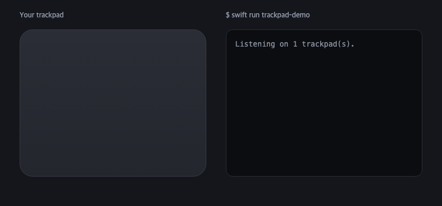

# TrackpadKit

**Read raw Mac trackpad touches in Swift, tell palms from fingers, and recognize tap gestures macOS doesn't have.**

<p align="center"></p>

macOS gives apps swipes and pinches through `NSEvent`, and nothing else. The trackpad knows far more than that: every finger's position, size and ellipse, around 100 times a second. TrackpadKit gives you that data, plus the two things you need right away once you have it — **palm rejection** and **gesture recognition** — in a small Swift package with no dependencies.

It's the engine behind [TokTok](https://apps.seoriarts.com/toktok/en?ref=github-trackpadkit), a trackpad gesture app for macOS.

## Install

Swift Package Manager:

```swift
.package(url: "https://github.com/hanseolhui/TrackpadKit", from: "1.0.0")
```

Or try it first:

```bash
git clone https://github.com/hanseolhui/TrackpadKit && cd TrackpadKit
swift run trackpad-demo            # prints gestures as you tap
swift run trackpad-demo --touches  # prints raw touches, palms marked 🖐
```

macOS 13+, Apple silicon and Intel. Reading touches needs **no** Accessibility permission.

## Gestures

```swift
import TrackpadKit

let trackpads = Multitouch()!            // keep a strong reference
GestureDetector.sliders = [.left, .right]
trackpads.onEvent = { event in            // called on the multitouch thread
    switch event {
    case .gesture(.tipTapLeft):  print("rest a finger, tap to its left")
    case .gesture(let g):        print(g)
    case .slider(let edge, let up): print(edge, up ? "up" : "down")
    }
}
trackpads.restart()
trackpads.watchDevices()                  // follows Magic Trackpads being connected / removed
```

| Gesture | How |
|---|---|
| `tipTapLeft` / `tipTapRight` | rest one finger, tap with a finger to its left / right |
| `twoFixTap{Left,Right,Middle}` · `threeFixTap{Left,Right}` | rest 2–3 fingers, tap beside or between them |
| `threeFingerTap` · `fourFingerTap` · `fiveFingerTap` | tap with several fingers at once |
| `corner{TopLeft,TopRight,BottomLeft,BottomRight}` · `edgeTopCenter` | one-finger tap in a corner / at the top center |
| `swipeInBottomRight` | swipe in from the bottom-right corner |
| `.slider(edge, up:)` | slide along an edge — left/right edges vertically, top/bottom horizontally |

Rest-and-tap is told apart from an ordinary two-finger tap (right click) by timing: the resting finger has to land first and stay still. Each trackpad gets its own detector, so fingers on the built-in pad and a Magic Trackpad never mix. Every threshold is in `Tuning`.

## Raw touches

```swift
trackpads.onTouches = { frame in
    for t in frame.touches where t.isTouching {
        print(t.id, t.x, t.y, t.size, t.majorAxis)   // x, y normalized 0…1, origin bottom-left
    }
}
```

`Touch` has the stable finger `id`, normalized position and velocity, `size`, the contact ellipse (`majorAxis`, `minorAxis`, `angle`) and the raw `state`.

## Palm rejection

Once you read raw touches, every palm resting on the trackpad while you type becomes a "finger". `PalmFilter` removes them:

```swift
let palms = PalmFilter(.normal)           // .gentle / .normal / .strong, or .fitted(...)
trackpads.onTouches = { frame in
    let (fingers, newPalm) = palms.filter(frame)
    if newPalm { /* a finger turned out to be a palm — cancel what it started */ }
    use(fingers)
}
```

The thresholds come from measuring real contacts on MacBook trackpads:

| Contact | `majorAxis` | `size` |
|---|---|---|
| Fingertip tap | 11–12 | 1.3–1.5 |
| Finger moving the pointer | 9–10 | 0.8–1.1 |
| Finger sliding along the edge | ~14 | ~1.1 |
| Palm / base of the thumb | **15–27** | any |
| Palm that only grazes the pad | 13–15 | **0.1–0.6** |

A contact is a palm if it's big (`majorAxis ≥ 15`), or medium but very light (`majorAxis ≥ 13` and `size < 0.7`). A touch that was ever classified as a palm stays one until it lifts, because palms often land on their edge and look finger-sized for a frame or two.

Two more things that helped a lot in practice (not part of the package, since they depend on your app):

- **Use the keyboard as a signal.** Ignore any hand that lands within about 1.2 s of a key press on the built-in trackpad (about 0.5 s on a Magic Trackpad), and cancel a gesture if a key is pressed while fingers are down. Skip key events your own app posts.
- **Require a firm tap in corners.** Palms land in the bottom corners most. Requiring `size ≥ 0.6` for corner taps separates deliberate taps (0.8–1.5) from grazes.

## Notes

- TrackpadKit loads Apple's **private** `MultitouchSupport.framework` at runtime with `dlsym`. It's what every trackpad utility uses, but it isn't public API: it may change in a future macOS, and it can't be used in Mac App Store apps.
- Callbacks run on the framework's own thread. Hop to the main thread before touching UI.
- Magic Mouse surfaces are ignored.

## Used by

- **[TokTok](https://apps.seoriarts.com/toktok/en?ref=github-trackpadkit)** — rest a finger and tap beside it to go back, tap corners to snap windows, slide edges for volume, and more. TrackpadKit is its free gesture engine.

If TrackpadKit is useful to you, a ⭐ helps other people find it. Issues and PRs welcome.

## License

MIT © SeoriArts
